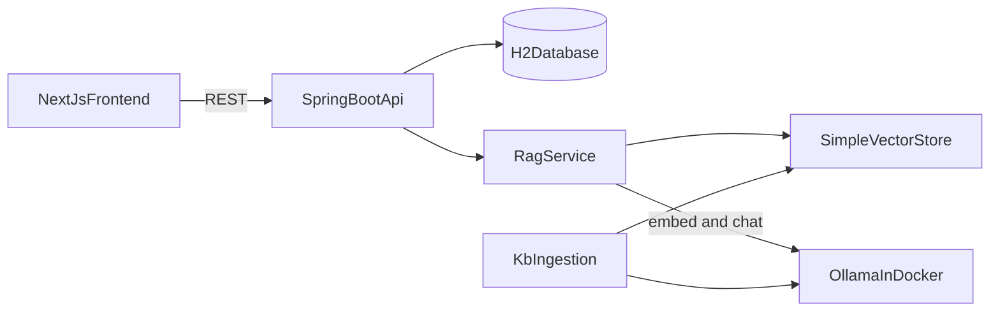

# Project Assessment

Assessment date: 2026-11-18. Based on read-only inspection of the repository and local machine, plus public documentation. Nothing here has been implemented yet.

## 1. Current repository structure

Root: `/Users/arpitdubey/codebase/ticket-management-system-c2`

```text
.
├── .cursor/
│   ├── commands/        review-code, review-spec, generate-tests, review-rag-output, implementation-plan (.md)
│   ├── rules/           java-springboot, testing, api-standards, rag-vector-store, ai-grounding (.mdc)
│   └── skills/documentation/SKILL.md
├── .cursorindexingignore
├── .specstory/
│   ├── .gitignore  .project.json  statistics.json
│   ├── cli/config.toml
│   └── history/         one session file
├── .vscode/settings.json
├── README.md
├── backend/             empty
├── docs/                ai-mistakes, architecture-decisions, prompt-history, project-assessment (.md)
├── frontend/            empty
└── spec/                10 placeholder spec files (.md)
```

Observations:

- Not a git repository (no `.git`), and there is no root `.gitignore`. The only `.gitignore` is `.specstory/.gitignore`, which ignores `/debug/` and `/statistics.json`.
- `backend/` and `frontend/` do not contain projects. They are empty directories.
- No `pom.xml`, `build.gradle`, `package.json`, Maven/Gradle wrapper, Docker or Compose file, `application.yml`/`application.properties`, or `AGENTS.md` exists.
- All Markdown, rule, command, and skill files from the setup step are placeholders (a title and one line).

### Cursor configuration

- Rules are `.mdc` files with `alwaysApply: false`, a `description`, and no `globs`. Cursor can offer these as "apply intelligently", but they hold no real guidance yet.
- Commands are plain `.md` files in `.cursor/commands/`, which maps to the `/command-name` slash menu. Cursor's newer direction is to put slash workflows in `.cursor/skills/`.
- The `documentation` skill has `disable-model-invocation: true`, so it only loads when invoked explicitly.
- Still to confirm in the IDE: the five rules, five commands, and the skill appear under Customize and the `/` menu.

### SpecStory

- `.specstory/.project.json` and `.specstory/cli/config.toml` exist. The config contains only commented defaults (local sync on, redaction of secrets on, cloud sync on when logged in).
- `.vscode/settings.json` sets `specstory.cloudSync.enabled` to `always`, so prompts are synced to SpecStory Cloud. Keep secrets out of prompts.
- `.cursorindexingignore` excludes `.specstory/**` from indexing; files can still be added with `@` references.
- Capture is verified for the first session: `.specstory/history/2026-11-18_09-47-30Z-first-go-through-the.md` contains the first prompt, and `.specstory/statistics.json` lists that session with provider `cursoride`.
- Because there is no git repository, the history is not versioned yet.

## 2. Existing technology versions

Versions found on this machine (not in the repository):

| Tool | Version | Notes |
|---|---|---|
| Java | Temurin 21.0.12 | Via SDKMAN; `JAVA_HOME` points at SDKMAN |
| Java (second JDK) | Corretto 21.0.12 | Under `~/Library/Java/JavaVirtualMachines`; also Java 21 |
| Maven | 3.9.16 | Homebrew |
| Gradle | not installed | |
| Node.js | v26.13.0 | npm 11.20.0 |
| Docker | 29.8.0 | Available |
| PostgreSQL (`psql`, `postgres`) | not installed | |
| Architecture | arm64 | macOS |

Versions in the repository: none. There is no Spring Boot, Spring AI, H2, React, or Next.js dependency declared anywhere, so no versions are assumed.

## 3. Missing components

- Git repository and root `.gitignore`.
- Maven project (and Maven wrapper so Maven does not need a system install).
- Spring Boot, Spring AI, and H2 scaffold.
- Next.js project.
- Docker Compose definition for Ollama.
- Embedding model choice (for example `nomic-embed-text`), a model pull strategy, and a chat model decision for RAG answers.
- Real content and scoping for Cursor rules; optional `AGENTS.md`.
- Spec content in `spec/` (all placeholders).
- Test setup, CI, seed data, and a knowledge-base corpus for RAG.

## 4. Proposed implementation architecture

Decisions recorded for this project:

- Database: H2 for tickets (embedded, no install).
- Vector store: Spring AI `SimpleVectorStore` (in-memory, optional JSON file persistence).
- Embedding model: Ollama running in Docker. It can also serve the chat model later.
- Assumed, not yet confirmed: Maven for the backend, Next.js for the frontend.



- Backend: Java 21, Spring Boot 4.x, Spring Web, Spring Data JPA, H2, Spring AI (Ollama starter plus a manual `SimpleVectorStore` bean), Maven.
- Frontend: Next.js (React) calling the REST API.
- Ollama runs in Docker, started through Spring Boot Docker Compose support or a manual `docker run`. No host installation.
- The vector index is rebuilt by re-ingesting at startup, or restored with `save()` and `load()` to a JSON file.

### Compatibility findings

Sources: [Spring AI getting started](https://docs.spring.io/spring-ai/reference/getting-started.html), [Spring AI PGvector reference](https://docs.spring.io/spring-ai/reference/api/vectordbs/pgvector.html), [Spring AI 2.1.0-RC2 announcement](https://spring.io/blog/2026/11/09/spring-ai-2-1-0-RC2-available-now/), [Spring AI releases](https://github.com/spring-projects/spring-ai/releases), [SimpleVectorStore source](https://github.com/spring-projects/spring-ai/blob/main/spring-ai-vector-store/src/main/java/org/springframework/ai/vectorstore/SimpleVectorStore.java), [embedded-postgres pgvector issue](https://github.com/fergusstrange/embedded-postgres/issues/163).

- Spring AI 2.0.x supports Spring Boot 4.0.x and 4.1.x. Spring AI 2.0.1 and 2.0.2 are the GA releases seen. Java 21 is used in published examples with this combination.
- Spring AI 2.1.0-RC2 is a pre-release that targets Spring Boot 4.2.0-RC2. Avoid it; pin GA versions only.
- Exact Spring Boot, Spring AI, and H2 versions are to be confirmed against start.spring.io and the Spring AI BOM before scaffolding.
- Spring Boot 4 is built on Spring Framework 7 with modularized starters and Jackson 3. This is general knowledge and should be confirmed when scaffolding.
- pgvector requires a PostgreSQL server with the `vector` extension. H2 cannot run it, and Zonky-based embedded PostgreSQL does not ship it. This is why the vector store here is `SimpleVectorStore`, and why pgvector remains a possible later upgrade (via Docker).
- `SimpleVectorStore` is in-memory, performs a linear cosine-similarity scan, and is documented as for testing and demonstration. It is not auto-configured by a starter, so it needs a manual bean.

## 5. Potential technical risks

- Scale and durability: `SimpleVectorStore` does not scale and loses data on restart unless persisted or rebuilt.
- New major versions: Spring Boot 4 and Spring AI 2.x are recent. Tutorials written for Boot 3 and Spring AI 1.x may not apply. Jackson 3 changes and starter renames are likely friction points.
- Pre-release drift: do not use release candidates or milestones.
- Ollama on macOS arm64 inside Docker runs on CPU only. Embedding and chat will be slower, and the first model pull is large and needs network access.
- Embedding dimension is tied to the model. Changing the model means a full re-index.
- Docker is a prerequisite even though the goal is to avoid installing tools on the machine.
- Node v26 is likely a non-LTS release. Confirm Next.js support and prefer an LTS version if problems appear.
- Two JDKs are visible. Ensure builds use Java 21 consistently.
- SpecStory cloud sync is set to always. Keep secrets out of prompts.
- Placeholder rules could be pulled into context as noise. Scope them before they carry real content.
- H2 SQL dialect differs from PostgreSQL. Avoid H2-only features so a later move to PostgreSQL stays easy.

## 6. Recommended implementation sequence

1. Initialize git, add a root `.gitignore`, and write real Cursor rules.
2. Write the specs: requirements, data model, state machine, API contract, RAG API contract, RAG ingestion, evaluation strategy, and test strategy.
3. Choose and pin the Spring Boot and Spring AI versions and the Ollama models.
4. Scaffold the backend (Maven wrapper, H2, REST skeleton) with tests.
5. Implement the ticket domain, state machine, and REST APIs.
6. Add Docker Compose for Ollama, the embedding pipeline, and ingestion into `SimpleVectorStore`.
7. Implement the RAG API and grounding checks, then the evaluation harness.
8. Scaffold the Next.js frontend and wire it to the API.
9. Hardening: persistence, CI, and documentation.
