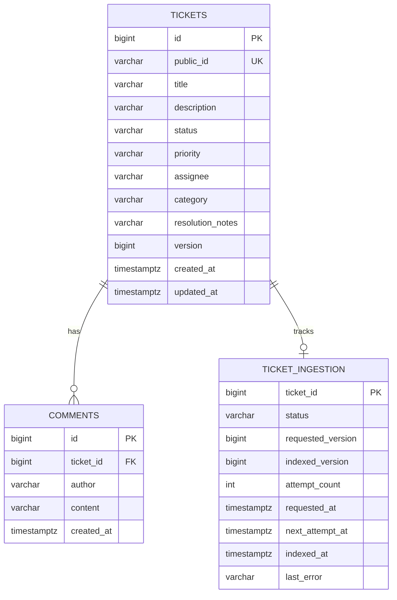

# Data Model

AI-Powered Support Ticket Management System.

Status: draft for review. Derived from `spec/requirements.md` and `spec/architecture.md`. This file defines tables, columns, constraints, indexes, and migration rules. It contains no entity or repository code and no migration scripts.

Ids: `DM-nn` are data-model decisions made here, `DQ-nn` are open questions. Requirement ids (FR, RAG, NFR, A) refer to `spec/requirements.md`.

---

## 1. Scope

Two tables were requested: `tickets` and `comments`. A third table, `ticket_ingestion`, is added because the requirements cannot be met without durable ingestion state: RAG-04 and RAG-05 require pending and failed ingestions to be recorded and retried, and NFR-OBS-03 requires counts and the age of the oldest pending ingestion. It is a supporting table and holds no ticket content.

Two columns beyond the requested list are also required by the requirements and are called out in the tables:

- `tickets.resolution_notes` (A-05, RAG-01).
- `tickets.version` (FR-05 AC6 concurrency, and the ingestion version marker).

---

## 2. Entity relationship

Relationships:

- One ticket has zero or many comments. A comment belongs to exactly one ticket.
- One ticket has at most one ingestion row, created with the ticket or at startup reconciliation.
- Resolution notes live on the ticket (one set per ticket, A-05), not in a separate table.

---

## 3. Conventions

| Topic | Rule |
|---|---|
| Engine | H2 in PostgreSQL compatibility mode, with SQL written to run unchanged on PostgreSQL (DM-01). |
| Naming | `snake_case`, plural table names. Constraint and index prefixes: `pk_`, `fk_`, `uq_`, `ck_`, `ix_`. |
| Integer ids | `BIGINT GENERATED BY DEFAULT AS IDENTITY`. |
| Text | `VARCHAR(n)` with `n` equal to the maximum in A-07. Limits are enforced by validation first and by the column as a hard ceiling. |
| Time | `TIMESTAMP WITH TIME ZONE`, always written in UTC (DM-02). |
| Enumerations | Stored as `VARCHAR` with a `CHECK` list, not as a database enum type, so they port cleanly (DM-03). |
| Blank text | Required text columns reject blank values with a `CHECK` on trimmed length. Values are also trimmed before storage (A-07). |
| Deletion | Not supported in v1 (section 8). No soft-delete column. |

---

## 4. Table `tickets`

Purpose: one row per support ticket.

### 4.1 Columns

| Column | SQL type | Null | Default | Notes |
|---|---|---|---|---|
| `id` | `BIGINT` | no | identity | Primary key. Internal only. Never exposed by the API. |
| `public_id` | `VARCHAR(20)` | no | none | Public ticket id, format `TKT-<number>` (A-02). Assigned by the backend from a sequence. Used in URLs, citations, and vector metadata. |
| `title` | `VARCHAR(120)` | no | none | A-07. |
| `description` | `VARCHAR(5000)` | no | none | A-07. |
| `status` | `VARCHAR(20)` | no | `'OPEN'` | One of `OPEN`, `IN_PROGRESS`, `RESOLVED`, `CLOSED`, `CANCELLED`. Changed only through a transition (FR-05). |
| `priority` | `VARCHAR(20)` | no | `'MEDIUM'` | One of `LOW`, `MEDIUM`, `HIGH`, `CRITICAL` (A-03). |
| `assignee` | `VARCHAR(100)` | yes | `NULL` | Free text (A-01). `NULL` means unassigned. Never an empty string. |
| `category` | `VARCHAR(30)` | no | none | From the configured list (A-04). Immutable after creation. |
| `resolution_notes` | `VARCHAR(2000)` | yes | `NULL` | Required when status is `RESOLVED`, immutable afterward (A-05). Added beyond the requested list. |
| `version` | `BIGINT` | no | `0` | Optimistic-locking counter. Incremented on every change that must trigger ingestion, including comment adds (DM-04). Added beyond the requested list. |
| `created_at` | `TIMESTAMP WITH TIME ZONE` | no | `CURRENT_TIMESTAMP` | Set once by the system. |
| `updated_at` | `TIMESTAMP WITH TIME ZONE` | no | `CURRENT_TIMESTAMP` | Refreshed on every update, comment add, and status change (FR-04 AC6, FR-05 AC1, FR-06 AC5). |

### 4.2 Constraints

| Name | Kind | Definition |
|---|---|---|
| `pk_tickets` | Primary key | `id` |
| `uq_tickets_public_id` | Unique | `public_id` |
| `ck_tickets_public_id_format` | Check | `public_id` starts with `TKT-` |
| `ck_tickets_status` | Check | `status` is one of the five statuses |
| `ck_tickets_priority` | Check | `priority` is one of the four priorities |
| `ck_tickets_title_not_blank` | Check | trimmed `title` is not empty |
| `ck_tickets_description_not_blank` | Check | trimmed `description` is not empty |
| `ck_tickets_category_not_blank` | Check | trimmed `category` is not empty |
| `ck_tickets_assignee_not_blank` | Check | `assignee` is `NULL` or its trimmed length is greater than zero |
| `ck_tickets_resolution_notes` | Check | `resolution_notes` is not blank when `status` is `RESOLVED` or `CLOSED`, and is `NULL` when `status` is `OPEN`, `IN_PROGRESS`, or `CANCELLED` |

Notes on the constraints:

- Category has no `CHECK` against a fixed list. The list is configuration (A-04), and a check would force a schema migration to add a category. Category values are validated by the application against configuration.
- `ck_tickets_resolution_notes` is defence in depth. The state machine allows `CLOSED` only after `RESOLVED`, so closed tickets always have notes, and no transition returns to an earlier status, so earlier statuses never have them. The application remains authoritative (DM-05).
- No foreign keys point out of `tickets`.

### 4.3 Public id generation

- A database sequence `ticket_public_seq` starts at 1001 and increments by 1 (A-02).
- The backend takes the next value and stores `TKT-` followed by that number in `public_id` before inserting.
- Rolled-back inserts can leave gaps in the numbering. Ids are unique and never reused, but not guaranteed gap-free. This is acceptable.
- The internal `id` and the public number are separate counters on purpose, so changing the public format never touches primary keys (DM-06).

### 4.4 Indexes

| Name | Columns | Purpose |
|---|---|---|
| `uq_tickets_public_id` | `public_id` | Lookup by public id (FR-03, FR-12 direct lookup, A-15). Created by the unique constraint. |
| `ix_tickets_updated_at` | `updated_at` descending, `id` descending | Default list order and pagination (A-09, FR-02). |
| `ix_tickets_status_updated_at` | `status`, `updated_at` descending, `id` descending | Status filter with the same ordering (FR-08). |

Keyword search (A-08) uses case-insensitive `LIKE` with a leading wildcard, which these indexes cannot accelerate. At about 1,000 tickets this is within NFR-PRF-01. If the volume grows, the options are PostgreSQL trigram indexes or full-text search, both out of scope for v1.

---

## 5. Table `comments`

Purpose: append-only comments on tickets (FR-06 AC2).

### 5.1 Columns

| Column | SQL type | Null | Default | Notes |
|---|---|---|---|---|
| `id` | `BIGINT` | no | identity | Primary key. Used as the `sourceRef` of the comment's vector chunks. Not exposed as a public id unless the API contract decides otherwise (DQ-01). |
| `ticket_id` | `BIGINT` | no | none | Foreign key to `tickets.id`. |
| `author` | `VARCHAR(100)` | no | none | Free text (A-01, A-07). |
| `content` | `VARCHAR(2000)` | no | none | Comment text (A-07). |
| `created_at` | `TIMESTAMP WITH TIME ZONE` | no | `CURRENT_TIMESTAMP` | Set once by the system. |

There is no `updated_at`, because comments cannot be edited.

### 5.2 Constraints

| Name | Kind | Definition |
|---|---|---|
| `pk_comments` | Primary key | `id` |
| `fk_comments_ticket` | Foreign key | `ticket_id` references `tickets(id)`, `ON DELETE RESTRICT`, `ON UPDATE RESTRICT` |
| `ck_comments_author_not_blank` | Check | trimmed `author` is not empty |
| `ck_comments_content_not_blank` | Check | trimmed `content` is not empty |

There is no unique constraint on comments. Identical text from the same author is allowed.

`ON DELETE RESTRICT` is chosen because ticket deletion is out of scope. If deletion is ever added, this must be revisited together with removing the ticket's vector chunks (DQ-02).

### 5.3 Indexes

| Name | Columns | Purpose |
|---|---|---|
| `ix_comments_ticket_created` | `ticket_id`, `created_at`, `id` | Load a ticket's comments in chronological order (FR-03 AC1), supports the foreign key, and speeds keyword search over comments by ticket. |

---

## 6. Table `ticket_ingestion` (supporting)

Purpose: durable record of what the vector index must contain, so ingestion can be retried and staleness can be measured (RAG-04, RAG-05, NFR-OBS-03). One row per ticket. It stores no ticket text.

### 6.1 Columns

| Column | SQL type | Null | Default | Notes |
|---|---|---|---|---|
| `ticket_id` | `BIGINT` | no | none | Primary key and foreign key to `tickets.id`. |
| `status` | `VARCHAR(10)` | no | `'PENDING'` | `PENDING`, `INDEXED`, or `FAILED`. |
| `requested_version` | `BIGINT` | no | none | The ticket `version` that must be indexed. |
| `indexed_version` | `BIGINT` | yes | `NULL` | The ticket `version` last indexed in the vector store. `NULL` means never indexed in this index lifetime. |
| `attempt_count` | `INTEGER` | no | `0` | Attempts since the current request was made. |
| `requested_at` | `TIMESTAMP WITH TIME ZONE` | no | `CURRENT_TIMESTAMP` | When the oldest unsatisfied request was made. Used to compute the age of the oldest pending ingestion. |
| `next_attempt_at` | `TIMESTAMP WITH TIME ZONE` | yes | `NULL` | When the worker may try again. Set for `PENDING` and retryable `FAILED` rows. |
| `indexed_at` | `TIMESTAMP WITH TIME ZONE` | yes | `NULL` | When `indexed_version` was reached. |
| `last_error` | `VARCHAR(500)` | yes | `NULL` | Short sanitized failure reason. Contains no ticket text and no secrets. |

### 6.2 Constraints

| Name | Kind | Definition |
|---|---|---|
| `pk_ticket_ingestion` | Primary key | `ticket_id` |
| `fk_ticket_ingestion_ticket` | Foreign key | `ticket_id` references `tickets(id)`, `ON DELETE RESTRICT` |
| `ck_ticket_ingestion_status` | Check | `status` is `PENDING`, `INDEXED`, or `FAILED` |
| `ck_ticket_ingestion_attempts` | Check | `attempt_count` is zero or greater |

### 6.3 Indexes

| Name | Columns | Purpose |
|---|---|---|
| `ix_ticket_ingestion_due` | `status`, `next_attempt_at` | Worker finds due rows. |
| `ix_ticket_ingestion_requested` | `status`, `requested_at` | Oldest-pending age and counts (NFR-OBS-03). |

### 6.4 Lifecycle

| Event | Effect on the row |
|---|---|
| Ticket create, update, comment add, or status change (same transaction) | Insert the row if missing. Otherwise set `requested_version` to the ticket's new `version`. Set `status` to `PENDING`, reset `attempt_count` to 0, set `next_attempt_at` to now. If the row was `INDEXED`, set `requested_at` to now. If it was already `PENDING` or `FAILED`, keep the earlier `requested_at` so the staleness age stays honest. |
| Worker success | Set `indexed_version` and `indexed_at`. Set `status` to `INDEXED` only if `requested_version` equals the version just indexed. Otherwise leave it `PENDING`, because a newer change arrived. Clear `last_error`. |
| Worker failure | Increment `attempt_count`, store a sanitized `last_error`, set `next_attempt_at` using backoff. After the configured maximum, set `status` to `FAILED` and clear `next_attempt_at`. |
| Startup reconciliation (A-12) | For every ticket: ensure a row exists, set `requested_version` to the current `version`, set `indexed_version` to `NULL`, set `status` to `PENDING`, reset `attempt_count`, set `next_attempt_at` to now. `FAILED` rows are included, so a restart retries them. |

Counts for metrics are `COUNT` by `status`. The age of the oldest pending ingestion is the current time minus the smallest `requested_at` among `PENDING` rows.

---

## 7. Support for RAG ingestion

### 7.1 Where each searchable item comes from (RAG-01)

| Knowledge document source | Table and column | Chunk `kind` | Chunk `sourceRef` |
|---|---|---|---|
| Ticket description | `tickets.description` | `DESCRIPTION` | `description` |
| Each comment | `comments.content` (one chunk set per row) | `COMMENT` | `comments.id` |
| Resolution notes | `tickets.resolution_notes` | `RESOLUTION_NOTES` | `resolution` |

The title (`tickets.title`) and `tickets.category` are written into each chunk's embedded header (see `spec/architecture.md` section 9). Comment author is included in a comment chunk's header.

### 7.2 Where each metadata value comes from (RAG-02, RAG-03)

| Chunk metadata key | Source |
|---|---|
| `ticketId` | `tickets.public_id` |
| `status` | `tickets.status` |
| `priority` | `tickets.priority` |
| `assignee` | `tickets.assignee`, or the fixed value `UNASSIGNED` when `NULL` (RAG-02) |
| `category` | `tickets.category` |
| `kind`, `sourceRef`, `chunkIndex` | Derived as in 7.1 |
| `ingestVersion` | `tickets.version` at the time of the read |
| `contentHash` | Hash of the chunk's source text |
| `title` | `tickets.title` |

Every key is derivable from the three tables. Nothing needed for a chunk has to be stored in the vector store only.

### 7.3 How the model meets the ingestion requirements

| Requirement | How the model supports it |
|---|---|
| RAG-01 | All three content sources are columns in the database and are read together. |
| RAG-02 | Every metadata value is a column. `NULL` assignee is mapped to `UNASSIGNED` at chunk time. |
| RAG-04 | Every ticket change increments `version` and upserts `ticket_ingestion` in the same transaction, so a change always leaves a durable ingestion request. Comment adds also increment `tickets.version` and update `tickets.updated_at`. |
| RAG-05 | Ingestion state is separate from ticket data. A failed ingestion changes only `ticket_ingestion`, never rolls back a ticket write. |
| RAG-05a | `ticket_ingestion.status` and `indexed_version` let reconciliation find tickets that are missing or behind. Deterministic chunk ids make repeats idempotent. |
| NFR-OBS-03 | Counts by `status` and the oldest `requested_at` are direct queries. |
| NFR-REL-02 | Retries are bounded by `attempt_count`. Rows that reach the limit remain visible as `FAILED`. |
| FR-05 AC6 | `tickets.version` is the optimistic-lock column. |

### 7.4 Consistent snapshot rule

The worker reads the ticket row and its comments in one read transaction and records `tickets.version` as the `ingestVersion`. If the version changes during embedding, the success update leaves the row `PENDING` (section 6.4), and a newer pass indexes the newer data. This avoids chunks that mix two versions of a ticket without holding any transaction open across model calls.

---

## 8. Business rules and where they are enforced

| Rule | Application | Database |
|---|---|---|
| Valid status transitions (section 5 of requirements) | Yes, authoritative | Only the allowed status values (`ck_tickets_status`) |
| Resolution notes required for `RESOLVED` | Yes | `ck_tickets_resolution_notes` as a backstop |
| No edits or comments on `CLOSED` or `CANCELLED` (A-06) | Yes | No. A cross-table rule is not expressible as a simple constraint. |
| Category from the configured list (A-04) | Yes | Not blank only |
| Category and resolution notes immutable | Yes | No |
| Comments append-only | Yes (no update or delete endpoint) | No |
| Field lengths | Yes, with messages (FR-10) | Column sizes as a hard ceiling |
| Public id uniqueness | Sequence | `uq_tickets_public_id` |

Out of scope in the model (requirements section 8): ticket deletion, comment edit or delete, attachments, users and accounts. There is no `users` table because `assignee` and `author` are free text (A-01).

---

## 9. Migration considerations

| Topic | Rule |
|---|---|
| Tool | Versioned, forward-only SQL migrations applied at startup, with Hibernate set to validate only (architecture AD-02, FR-09 AC3). |
| Naming | One migration per change, with an ascending version and a descriptive name. Applied migrations are never edited. |
| Baseline | Version 1 creates the sequence, `tickets`, `comments`, `ticket_ingestion`, and all constraints and indexes in this file. Seed data is not part of it. |
| Sequence start | `ticket_public_seq` starts at 1001 (A-02). |
| Test data | Tests use in-memory H2 with the same migrations, so the schema under test is the real schema. |
| Production-like data | The file-backed database is created by the same migrations on first start. The file location is configuration. |
| Adding a category | No migration needed (configuration). |
| Changing a text limit (A-07) | Needs a migration to widen the column, and a matching validation change. Narrowing needs a data check first. |
| Adding a status or priority value | Needs a migration that replaces the `CHECK` constraint, plus a state-machine and spec change. |
| Changing the embedding model | No schema change. It requires a full re-index, which startup reconciliation already performs. |
| Adding ticket deletion later | Requires deciding `ON DELETE` behavior for `comments` and `ticket_ingestion`, and removing the ticket's chunks from the vector store. |
| Moving to PostgreSQL | Keep the SQL portable: identity columns, `TIMESTAMP WITH TIME ZONE`, `VARCHAR`, `CHECK`, and sequences work on both. Verify case-insensitive search (`LOWER` with `LIKE`), `NULL` ordering in the descending indexes, and sequence syntax at that time. |
| Backups | Out of scope for v1. The H2 file is the only copy of ticket data and should be backed up by the operator. |

---

## 10. Assumptions and open questions

| Id | Item | Status |
|---|---|---|
| DM-01 | H2 is run in PostgreSQL compatibility mode and SQL is kept portable. | Decision |
| DM-02 | All timestamps are UTC with time zone. | Decision |
| DM-03 | Enumerations are `VARCHAR` plus `CHECK`, not native enums. | Decision |
| DM-04 | Any change that must trigger ingestion increments `tickets.version`, including comment adds. | Decision |
| DM-05 | The database holds only simple backstop constraints. The application owns business rules. | Decision |
| DM-06 | Internal `id` and public `public_id` are separate. The public number comes from its own sequence. | Decision |
| DQ-01 | Whether comments need a public id in the API. Default: no, the database id stays internal and ordering is by creation time. Settle in `spec/api-contract.md`. | Open |
| DQ-02 | Behavior on ticket deletion if it is ever added. | Open, out of scope |
| DQ-03 | Whether to store a content hash per ticket in `ticket_ingestion` to skip re-embedding when only metadata changed. Not needed in v1, because whole-ticket re-ingestion is small. | Open, optimization |

---

## 11. Traceability

| Requirement | Where addressed |
|---|---|
| FR-01, FR-02, FR-03, FR-04 | Section 4 (columns, defaults, indexes) |
| FR-05, FR-05 AC6 | Sections 4.1 (`status`, `version`), 4.2, 8 |
| FR-06 | Section 5, 7.3 |
| FR-07, FR-08 | Section 4.4 |
| FR-09 | Sections 3, 9 |
| FR-10 | Sections 3, 8 |
| A-02, A-03, A-04, A-05, A-06, A-07, A-11 | Sections 4, 5, 8, 9 |
| RAG-01, RAG-02, RAG-03 | Section 7.1, 7.2 |
| RAG-04, RAG-05, RAG-05a | Sections 6, 7.3, 7.4 |
| NFR-OBS-03, NFR-REL-02 | Sections 6.4, 7.3 |
