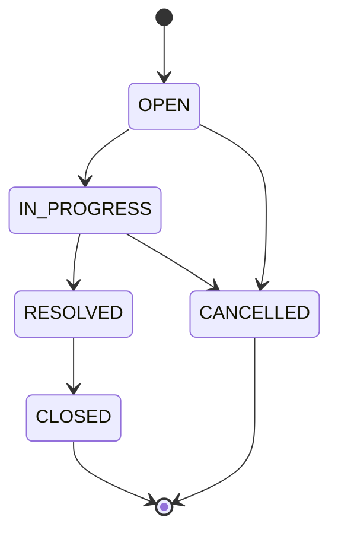

# State Machine

Ticket status transitions for the AI-Powered Support Ticket Management System.

Status: draft for review. Derived from `spec/requirements.md` (section 5, FR-05), `spec/architecture.md`, and `spec/data-model.md`. This file defines allowed and rejected transitions, the HTTP result, and the tests that lock the behavior. It contains no implementation code.

The status change endpoint is `POST /api/tickets/{publicId}/status`, specified in `spec/api-contract.md`. `PUT /api/tickets/{publicId}` cannot change status (FR-04 AC3).

## Contract decision: HTTP 400

An invalid transition is rejected by the backend with **HTTP 400 Bad Request**. The ticket is not changed.

Earlier drafts mapped an illegal transition to HTTP 409. This contract replaces that. `spec/requirements.md` (FR-05 AC2), `spec/architecture.md` (error table), and `.cursor/rules/api-standards.mdc` are aligned with 400.

Why the backend rejects it, and why the status is 400:

1. The UI is not trusted. It may hide illegal options, but a client can call the API directly. Only the backend can guarantee the transition table (FR-05, FR-10). A transition the table does not list is an invalid request, not a successful write.
2. The target status is not an acceptable value for this ticket. That is the same class of error as an unknown status value (FR-05 AC7), which is already 400. Examples that must fail this way include `CLOSED → OPEN`, `RESOLVED → OPEN`, and `CANCELLED → OPEN`.
3. HTTP 409 is reserved for a real conflict between two valid requests, or for a write that is well-formed but forbidden because the ticket is terminal:
   - two concurrent valid transitions, where the loser loses the optimistic lock on `tickets.version` (FR-05 AC6)
   - a field update or a new comment on a `CLOSED` or `CANCELLED` ticket (FR-04 AC5, FR-06 AC3)
   An illegal transition is illegal even when nobody else is writing, so it is not a conflict.
4. 400 lets the UI treat the failure as a validation error on the status control and show the current status and the allowed next statuses (FR-11 AC2). It is not a missing ticket (404) and not a server failure (500).

A 400 response names the current status, the requested status, and the allowed next statuses. If there are no allowed next statuses, the message says so.

## Statuses

| Status | Meaning | Terminal |
|---|---|---|
| `OPEN` | Created and not yet being worked | no |
| `IN_PROGRESS` | Someone is working on it | no |
| `RESOLVED` | A fix or answer is recorded in resolution notes | no |
| `CLOSED` | Confirmed finished | yes |
| `CANCELLED` | Abandoned | yes |

`CLOSED` and `CANCELLED` have no outgoing transitions. Field updates and new comments are also rejected on them (A-06), as HTTP 409, which is specified in `spec/api-contract.md`.

## Valid transitions

| From | To | Extra rule |
|---|---|---|
| `OPEN` | `IN_PROGRESS` | |
| `OPEN` | `CANCELLED` | |
| `IN_PROGRESS` | `RESOLVED` | `resolutionNotes` is required and non-blank (A-05). Missing or blank notes are HTTP 400 and the status stays `IN_PROGRESS`. |
| `IN_PROGRESS` | `CANCELLED` | |
| `RESOLVED` | `CLOSED` | |

Each successful transition updates `status` and `updated_at`, increments `version`, and requests re-ingestion (FR-05 AC1, RAG-04). Moving to `RESOLVED` stores the resolution notes. Those notes are not editable afterward (A-05).

## Invalid transitions

Anything not in the table above is rejected with HTTP 400. The row is unchanged: status, notes, version, and timestamps stay as they were, and no ingestion request is written.

Rejected cases include:

- Same-status requests: `OPEN → OPEN`, `IN_PROGRESS → IN_PROGRESS`, `RESOLVED → RESOLVED`, `CLOSED → CLOSED`, `CANCELLED → CANCELLED`.
- Skipping a step: `OPEN → RESOLVED`, `OPEN → CLOSED`, `IN_PROGRESS → CLOSED`.
- Moving backward: `IN_PROGRESS → OPEN`, `RESOLVED → IN_PROGRESS`, `RESOLVED → OPEN`.
- Leaving a terminal state: every transition from `CLOSED` or `CANCELLED`.
- `RESOLVED → CANCELLED`. It is not in the allowed list, so it is rejected.
- An unknown status string, which is also HTTP 400 (FR-05 AC7).
- An unknown ticket id, which is HTTP 404 and is not a transition error.

Named examples that must be rejected: `CLOSED → OPEN`, `RESOLVED → OPEN`, `CANCELLED → OPEN`.

## Transition matrix

A = allowed. X = rejected with HTTP 400. The ticket is unchanged for every X.

| From \ To | OPEN | IN_PROGRESS | RESOLVED | CLOSED | CANCELLED |
|---|---|---|---|---|---|
| OPEN | X | A | X | X | A |
| IN_PROGRESS | X | X | A (notes required) | X | A |
| RESOLVED | X | X | X | A | X |
| CLOSED | X | X | X | X | X |
| CANCELLED | X | X | X | X | X |

## State diagram



No other arrows exist. `CLOSED` and `CANCELLED` are terminal.

## Exception handling

| Situation | HTTP | Body `code` | Ticket |
|---|---|---|---|
| Target status is not an allowed next status, including same-status | 400 | `INVALID_TRANSITION` | unchanged |
| Target status is not one of the five statuses | 400 | `VALIDATION_ERROR` | unchanged |
| `RESOLVED` requested without non-blank resolution notes | 400 | `VALIDATION_ERROR` | unchanged |
| Ticket id does not exist | 404 | `NOT_FOUND` | n/a |
| Two valid transitions race; this request loses the version check | 409 | `CONFLICT` | the winning transition stands |
| Unexpected failure while applying a valid transition | 500 | `INTERNAL_ERROR` | unchanged (transaction rolls back) |

The service raises a specific unchecked exception (`InvalidTransitionException` for a rejected transition, a validation exception for bad input). One `@RestControllerAdvice` maps it to the error body in `spec/api-contract.md`. The exception is not swallowed and is not returned as HTTP 500.

The transition check and the write run in one transaction. A rejected transition writes nothing. The version check is the optimistic lock on `tickets.version` (data model DM-04).

## Error response examples

Rejected `CLOSED → OPEN`:

```json
{
  "status": 400,
  "error": "Bad Request",
  "code": "INVALID_TRANSITION",
  "message": "Cannot change status from CLOSED to OPEN. Allowed next statuses: none.",
  "path": "/api/tickets/TKT-1001/status",
  "timestamp": "2026-11-18T11:00:00Z",
  "fieldErrors": [
    {
      "field": "status",
      "message": "CLOSED cannot transition to OPEN."
    }
  ]
}
```

Rejected `OPEN → RESOLVED`:

```json
{
  "status": 400,
  "error": "Bad Request",
  "code": "INVALID_TRANSITION",
  "message": "Cannot change status from OPEN to RESOLVED. Allowed next statuses: IN_PROGRESS, CANCELLED.",
  "path": "/api/tickets/TKT-1002/status",
  "timestamp": "2026-11-18T11:00:00Z",
  "fieldErrors": [
    {
      "field": "status",
      "message": "OPEN cannot transition to RESOLVED."
    }
  ]
}
```

`IN_PROGRESS → RESOLVED` without notes:

```json
{
  "status": 400,
  "error": "Bad Request",
  "code": "VALIDATION_ERROR",
  "message": "Resolution notes are required to resolve a ticket.",
  "path": "/api/tickets/TKT-1003/status",
  "timestamp": "2026-11-18T11:00:00Z",
  "fieldErrors": [
    {
      "field": "resolutionNotes",
      "message": "must not be blank"
    }
  ]
}
```

Lost optimistic lock (HTTP 409, not a transition rejection):

```json
{
  "status": 409,
  "error": "Conflict",
  "code": "CONFLICT",
  "message": "Ticket TKT-1004 was updated by someone else. Reload it and try again.",
  "path": "/api/tickets/TKT-1004/status",
  "timestamp": "2026-11-18T11:00:00Z"
}
```

## Integration test scenarios

These run against the HTTP API and the database. The state machine itself is also unit-tested over the full matrix without HTTP (NFR-TST-01). Each scenario asserts the HTTP status, the error `code` when the call fails, and the stored status.

| Id | Given | When | Then |
|---|---|---|---|
| SM-01 | A new ticket | `OPEN → IN_PROGRESS` | 200, status `IN_PROGRESS`, version incremented |
| SM-02 | `IN_PROGRESS` and non-blank notes | `IN_PROGRESS → RESOLVED` | 200, notes stored, status `RESOLVED` |
| SM-03 | `RESOLVED` | `RESOLVED → CLOSED` | 200, status `CLOSED` |
| SM-04 | `OPEN` | `OPEN → CANCELLED` | 200, status `CANCELLED` |
| SM-05 | `IN_PROGRESS` | `IN_PROGRESS → CANCELLED` | 200, status `CANCELLED` |
| SM-06 | `CLOSED` | `CLOSED → OPEN` | 400 `INVALID_TRANSITION`, status still `CLOSED` |
| SM-07 | `RESOLVED` | `RESOLVED → OPEN` | 400 `INVALID_TRANSITION`, status still `RESOLVED` |
| SM-08 | `CANCELLED` | `CANCELLED → OPEN` | 400 `INVALID_TRANSITION`, status still `CANCELLED` |
| SM-09 | `OPEN` | `OPEN → RESOLVED` and `OPEN → CLOSED` | 400 each, status still `OPEN` |
| SM-10 | `IN_PROGRESS` | `IN_PROGRESS → OPEN` and `IN_PROGRESS → CLOSED` | 400 each, status still `IN_PROGRESS` |
| SM-11 | `RESOLVED` | `RESOLVED → IN_PROGRESS` and `RESOLVED → CANCELLED` | 400 each, status still `RESOLVED` |
| SM-12 | Each of the five statuses | same status requested | 400 `INVALID_TRANSITION`, row unchanged |
| SM-13 | Every other cell of the matrix marked X | that transition | 400, row unchanged |
| SM-14 | `IN_PROGRESS` | `RESOLVED` with missing, blank, or whitespace-only notes | 400 `VALIDATION_ERROR`, status still `IN_PROGRESS`, notes still null |
| SM-15 | Any ticket | status `DONE` or empty | 400 `VALIDATION_ERROR`, row unchanged |
| SM-16 | No such ticket | any status | 404 `NOT_FOUND` |
| SM-17 | Two concurrent valid transitions from `OPEN` | both sent with the same version | one 200, the other 409 `CONFLICT`; stored status matches the winner only |
| SM-18 | A successful transition | read the ticket after the call | `updatedAt` changed and an ingestion request exists for the new version (RAG-04) |
| SM-19 | A rejected transition | read the ticket after the call | no ingestion request was added |
