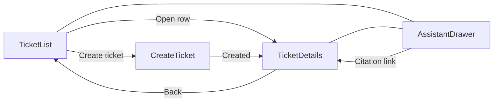

# UI Flow

Support-agent screens and the paths between them.

Status: draft for review. Derived from `spec/requirements.md` (FR-01 to FR-14), `spec/api-contract.md`, `spec/rag-api-contract.md`, `spec/state-machine.md`, and `spec/architecture.md` section 4. This file describes screens and behavior. It contains no frontend code.

The backend is authoritative. The UI may hide illegal actions, but every rejection still comes from the API (FR-05, FR-10).

## 1. Screens

| Screen | Route | Purpose |
|---|---|---|
| Ticket list | `/tickets` | Browse, search, filter, paginate |
| Create ticket | `/tickets/new` | Create a ticket |
| Ticket details | `/tickets/[ticketId]` | Read, edit, change status, comment |
| Assistant drawer | no route | Ask a question over ticket history |

`[ticketId]` is the public id, for example `TKT-1001`. There is no `/ask` page. The assistant is a drawer so the agent can read a ticket and ask about history without leaving it. An earlier architecture note listed `/ask`. This file replaces that.

Shared chrome on every screen:

- A link to the ticket list.
- A button labeled **Ask assistant** that opens the drawer. Opening it does not change the route.
- Ticket text and assistant text are rendered as plain text. Nothing from a ticket or an answer is inserted as HTML (NFR-SEC-03).

## 2. Assumptions

| Id | Assumption |
|---|---|
| UI-A1 | There is no signed-in user (A-01). Comment author is typed each time. The last author is remembered in the browser for the session only, so it is not asked for twice. It is not an account. |
| UI-A2 | The drawer stays open when a citation link changes the page, so the answer remains visible next to the ticket. |
| UI-A3 | One viewport is specified: a desktop width. A usable layout at a narrow width is desirable and is not a v1 acceptance criterion. |

## 3. Ticket list

Entry: opening the app lands on `/tickets`.

The page shows:

- A **New ticket** action that goes to `/tickets/new`.
- The search box and status filter from section 9.
- A table, one row per ticket, newest update first (FR-02 AC1). Each row shows ticket id, title, status, priority, assignee, category, and updated time (FR-02 AC2). An empty assignee is shown as "Unassigned".
- Pagination: page size defaults to 20. Next and previous are disabled at the ends. The current page, size, search term, and status are kept in the URL query (`page`, `size`, `q`, `status`) so refresh and the back button restore the same list.

Selecting a row goes to `/tickets/[ticketId]`.

Empty states, which are not errors (FR-02 AC3, FR-07 AC3):

- No tickets at all: "No tickets yet" and the **New ticket** action.
- Search or filter matched nothing: "No tickets match your search" and a way to clear the search and filter.

A failed list request shows the error banner from section 13 and leaves the table empty. It does not show a stack trace or the raw response.

## 4. Ticket creation

Route: `/tickets/new`.

Fields:

| Field | Control | Rule |
|---|---|---|
| Title | text | Required, 1–120 characters |
| Description | multiline text | Required, 1–5000 |
| Category | select | Required. Options: `PAYMENT`, `SHIPPING`, `ACCOUNT`, `TECHNICAL`, `OTHER` |
| Priority | select | Optional. Options: `LOW`, `MEDIUM`, `HIGH`, `CRITICAL`. The control starts on `MEDIUM` |
| Assignee | text | Optional. Empty means unassigned |

There is no status, ticket id, or resolution-notes field. The server sets status to `OPEN` and assigns the id.

**Create ticket** sends `POST /api/tickets`. On 201 the UI goes to `/tickets/[ticketId]` and shows the new ticket (FR-01 AC5).

On 400, each `fieldErrors` entry is shown under its field, using the backend message (FR-11 AC1). Text the agent typed stays in the form (FR-11 AC5). Nothing is created.

**Cancel** returns to the list without saving. If any field has been edited, the UI asks for confirmation before discarding.

## 5. Ticket details

Route: `/tickets/[ticketId]`. Loads `GET /api/tickets/{publicId}`.

The page shows every field: id, title, description, category, priority, status, assignee, resolution notes when present, created time, and updated time (FR-03 AC1). Comments are listed oldest first, each with author, text, and time.

A 404 shows a page that says the ticket was not found, with a link back to the list (FR-03 AC2). It is not a blank page.

The page also shows the actions in sections 6, 7, and 8. While the ticket is `CLOSED` or `CANCELLED`, edit and comment controls are disabled and a note says the ticket can no longer be changed (A-06). The status control shows no next statuses. The backend still enforces this if a request is sent anyway.

## 6. Editing tickets

On an editable ticket, **Edit** reveals the title, description, priority, and assignee. Category, status, id, resolution notes, and comments are shown but not editable (FR-04 AC3).

**Save** sends `PUT /api/tickets/{publicId}` with only the fields that changed. Assignee can be cleared, which sends `null` (FR-04 AC4).

On 200 the page shows the updated ticket and leaves edit mode. On 400, field messages appear and edit mode stays open with the typed values (FR-11 AC1, AC5). On 409 (terminal ticket), a banner says the ticket is closed or cancelled and cannot be updated. On 404, the not-found page replaces the form.

## 7. Changing status

The details page lists only the transitions allowed from the current status (FR-03 AC3). This list is a convenience. The server decides.

| Current | Actions shown |
|---|---|
| `OPEN` | Start progress, Cancel ticket |
| `IN_PROGRESS` | Resolve, Cancel ticket |
| `RESOLVED` | Close ticket |
| `CLOSED` | none |
| `CANCELLED` | none |

**Resolve** asks for resolution notes before sending. Notes are required, 1–2000 characters. The other actions send `POST /api/tickets/{publicId}/status` immediately.

On 200 the page reloads the ticket and the actions change to match the new status.

On 400 with code `INVALID_TRANSITION`, a banner shows the backend message, which names the current status, the requested status, and the allowed next statuses (FR-05 AC2, FR-11 AC2). The ticket display is refreshed from the server so it cannot show a status the server rejected.

On 400 with code `VALIDATION_ERROR` (missing notes, unknown status), the message is shown on the notes field or the banner, and the status does not change.

On 409, a banner says the ticket changed elsewhere and the page reloads it.

## 8. Adding comments

Below the comment list, an editable ticket shows author and comment text.

| Field | Rule |
|---|---|
| Author | Required, 1–100. Prefilled with the last author used in this browser session (UI-A1) |
| Comment | Required, 1–2000. Sent as `content` |

**Add comment** sends `POST /api/tickets/{publicId}/comments`. On 201 the new comment appears at the bottom and the box clears. The author is kept. There is no edit or delete control (FR-06 AC2).

On 400, messages sit under the fields and the typed text remains. On 409, a banner says comments cannot be added to a closed or cancelled ticket. On 404, the not-found page is shown.

## 9. Searching and filtering

On the list page:

- A search box bound to `q`. Submitting, or pausing after typing, updates the URL and reloads page 0.
- A status select bound to `status`, with "All statuses" plus the five statuses. Changing it reloads page 0.
- Both apply together (FR-07 AC5, FR-08 AC4).
- Clearing the box, or choosing "All statuses", removes that constraint. An empty search is the full list (FR-07 AC4).
- A term longer than 100 characters is not sent. The box shows the length error from the client, and the backend remains the check if it is sent anyway (FR-10).
- Characters such as `%` are sent as ordinary text (FR-07 AC6).

Search uses the ticket API only. It does not call the assistant and does not show answers (FR-07 AC7).

## 10. AI assistant drawer

**Ask assistant** opens a panel over the current page. Closing it discards nothing already on the ticket page. The drawer contains:

- A short explanation: answers come only from existing tickets.
- A question box, 1–500 characters, and an **Ask** button.
- A region for the result: empty until the first question, then one of the states in sections 11 to 13.

**Ask** sends `POST /api/ai/ask` with `{ "question": "..." }`. While the request is in flight the button is disabled and a waiting message is shown. A second question replaces the previous result. The drawer does not create, edit, or close tickets, and it has no other actions (FR-12 AC6).

The question box keeps its text if the request fails (FR-11 AC5).

## 11. Displaying AI answers

A grounded answer (`grounded` true) is shown as plain text, with citation markers left readable. It is not an error style.

Under the answer, a **Sources** list shows one entry per citation (section 12). If `grounded` is true and `citations` is empty, the UI does not invent sources. It shows the answer and a note that no source was returned. That response would violate the API contract, so it is treated as a display fallback rather than a normal case.

## 12. Displaying ticket citations

Each citation shows:

- The ticket id as a link to `/tickets/[ticketId]` (FR-13 AC4).
- The snippet, when present, as plain text under the link.

Following a link navigates to that ticket and leaves the drawer open (UI-A2). The agent can compare the answer with the ticket. An unknown id still goes to the details route, which shows the not-found page if the server has no such ticket.

The UI does not add citations the response did not include.

## 13. No relevant tickets found

When the response is HTTP 200, `grounded` is false, and `answer` is `No relevant tickets found.`:

- The sentence is shown as written.
- No sources are shown.
- The region uses an informational style, not the error style (FR-14 AC4).
- The question remains in the box so the agent can rephrase it.

This is the same display for an off-topic question and for a question that names a ticket the system cannot support (FR-14 AC5).

## 14. API and validation errors

The client maps the error `code` to a message. It never renders the raw JSON body, a stack trace, or an empty page (FR-11 AC3).

| Situation | `code` | What the agent sees |
|---|---|---|
| Invalid field | `VALIDATION_ERROR` with `fieldErrors` | The backend message under that field |
| Invalid field with no field list | `VALIDATION_ERROR` | The `message` in a banner |
| Illegal status change | `INVALID_TRANSITION` | A banner with the current status and the allowed next statuses (FR-11 AC2) |
| Missing ticket | `NOT_FOUND` | "This ticket was not found" and a link to the list |
| Closed or cancelled ticket, or a lost update race | `CONFLICT` | The backend `message` in a banner, then the page reloads the ticket |
| Assistant unavailable, timed out, or index still rebuilding | `SERVICE_UNAVAILABLE` | "The assistant is unavailable. Try again later." This uses the error style (FR-11 AC4) |
| Network failure, or a response that is not JSON | none | "The server could not be reached." Ticket pages and the drawer both show this |
| Anything else, including 500 | `INTERNAL_ERROR` or unknown | "Something went wrong. Try again." No technical detail |

Validation and transition errors keep the form values. A no-match result is never shown with these error styles, and an assistant failure is never shown as "No relevant tickets found."

## 15. Traceability

| Journey | Requirements |
|---|---|
| List, empty state, pagination | FR-02 |
| Create | FR-01, FR-11 |
| Details and not-found | FR-03 |
| Edit | FR-04, A-06 |
| Status | FR-03 AC3, FR-05, FR-11 AC2 |
| Comments | FR-06 |
| Search and filter | FR-07, FR-08 |
| Drawer, answers, citations, no-match | FR-12, FR-13, FR-14 |
| Errors | FR-10, FR-11, NFR-SEC-03, NFR-SEC-05 |
